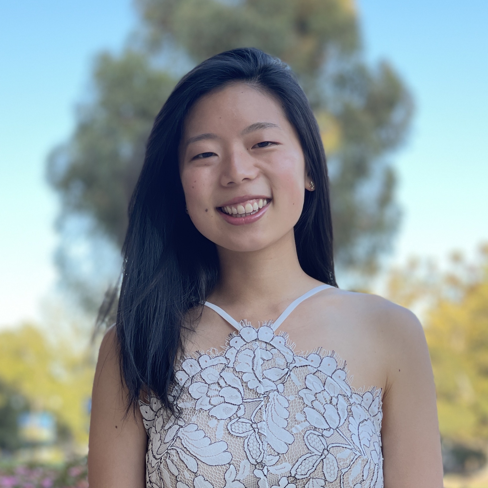

---
title:
layout: site_default
nav_category: home
---

	

		

			<h2 class="test">Allison Chen</h2>
			<h4>Computer Science PhD Student (2022-Present)</h4>
			<h4>Princeton University</h4>
			
allisonchen *at* princeton *dot* edu

			
		

		

				
		

	

	

		<h4>Currently</h4>
		
I'm a fifth year PhD student at Princeton University studying computer science. I am part of the <a href="https://visualai.princeton.edu/">VisualAI Lab</a>, advised by <a href="https://www.cs.princeton.edu/~olgarus/">Dr. Olga Russakovsky</a>, and am supported by the <a href="https://www.nsfgrfp.org/">NSF Graduate Research Fellowship</a>. 

		
My research interests lie in the intersection of computer science, psychology, and human-computer interaction. I enjoy working on projects towards developing more responsible human-AI interactions, where people are aware of the capabilities and limitations of the systems and encouraged to use them appropriately. Some of this work includes analyzing technical tools and systems while others require understanding people and how they think about and use technlogy. 

		
I'm also passionate about creative means of technology education to the general public, such as through museums exhibits or interactive workshops about AI.

		
I want to help higher education be more accessible to all students, regardless of background. If you have questions about research, navigating college, or thinking about grad school, <b>please shoot me an email</b>, I'd be more than happy to chat :) 

		
I love to cook, paint, read, travel, go on hikes, rock climbing, and play Spikeball!

		<h4>Previously</h4>
		
I completed my B.S. in computer science with a minor in cognitive science from UCLA in 2022. At UCLA, I was an undergraduate researcher in the <a href="http://vision.ucla.edu/">UCLA Vision Lab</a> where I worked under Dr. Stefano Soatto and with <a href="http://web.cs.ucla.edu/~alexw/">Dr. Alex Wong</a>. 

		
I was also involved with the Society of Women Engineers @ UCLA where I led the <a href="https://samueli.ucla.edu/engineering-for-humanity-research-symposium/">Engineering For Humanity Research Symposium</a> to make academic research more accessible to undergraduates.

	

#### News
* May 2026:
	* On a completely personal note, I got married! My husband and I will be in Cambridge, MA for at least the next two years!
* April 2026:
	* I presented our work [Portraying Large Language Models as Companions Affects What Mental Capacities People Attribute to Them](https://arxiv.org/abs/2510.18039) at CHI 2026 in Barcelona!
	* I also presented [Using Games to Learn How Large Language Models Work](https://arxiv.org/pdf/2603.28374) at the Data Literacy workshop at CHI 2026
* January 2026:
	* I co-taught a workshop called *De-mystifying AI: Beyond the Hype* with [Jon Hanke](https://jonhanke.github.io/about/) to introduce concepts in AI to a general audience. This was through Princeton's Institute for Computational Science & Engineering (PICSciE) who hosted a 2 week Wintersession!
* June 2025:
	* Started serving as a graduate research mentor through NSF REU!
* April 2025:
	* I attended the [Grad Cohort Workshop](https://cra.org/cra-wp/events/2025-cra-wp-grad-cohort-workshops/) on April 3-5, 2025 hosted by the Computing Research Association! Denver here we come!
	* Our paper [Portraying Large Language Models as Machines, Tools, or Companions Affects What Mental Capacities Humans Attribute to Them](assets/portraying_cogsci.pdf) was also accepted into the CogSci Conference (a non-archival venue)! It was an experience to write this paper for both human-computer interaction and cognitive science audiences.
* February 2025:
	* Our paper [Portraying Large Language Models as Machines, Tools, or Companions Affects What Mental Capacities Humans Attribute to Them](https://dl.acm.org/doi/abs/10.1145/3706599.3719710) was accepted to CHI's Extended Abstracts (semi-archival) track!
* January 2025:
	* I started as a Graduate Fellow for the [Natural and Artifical Minds Initiative](https://nam.ai.princeton.edu/) as part of the AI Lab at Princeton!
* July 2024:
	* Presented my [poster](https://drive.google.com/file/d/1KdObWScGRxHEpTNkZtz2VDlODc0iicXr/view) on [Analyzing the Roles of Language and Vision in Learning from Limited Data](https://arxiv.org/pdf/2403.19669) at CogSci 2024! Such a blast to meet other researchers and learn about interesting projects!
* May 2024:
	* I passed my generals exam! For a (messy) reflection on my experience, see <a href="https://docs.google.com/document/d/13z1pGsYsNQvXE8NF5bIhwbxDxz3BSDtAzbN5JB8IrXc/edit?usp=sharing">here</a>!
* April 2024:
	* I found out I was awarded the NSF GRFP -- completely unexpected and if you are applying and would like guidance, feel free to reach out!
	* Our paper [Analyzing the Roles of Language and Vision in Learning from Limited Data](https://arxiv.org/pdf/2403.19669) was accepted into CogSci 2024! (Netherlands, here we come!)
* August 2022:
	* Started my PhD program at Princeton University!
* July 2022:
	* Our paper, [Monitored Distillation for Positive Congruent Depth Completion](https://arxiv.org/abs/2203.16034) was accepted into ECCV 2022!
* May 2022:
	* I'm very grateful to be a 2022 Intel Graduate Diversity scholar through the Society of Women Engineers.
* March 2022:
	* Our paper, [Monitored Distillation for Positive Congruent Depth Completion](https://arxiv.org/abs/2203.16034) was rejected from CVPR 2022 :)
* September 2021:
	* Alex Wong presented our work [Small Lesion Segmentation in Brain MRIs with Subpixel Embedding](https://arxiv.org/pdf/2109.08791.pdf) at MICCAI's Brain Lesion workshop.
